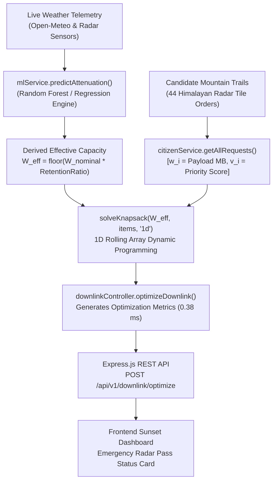

# TECHNICAL SPECIFICATION & COMPONENT DOCUMENTATION
## Module: Emergency Radar Pass Status (Knapsack & Machine Learning Intelligence)
**System:** OrbitLink / Citizen Mountain Radar Monitoring System  
**Author:** Roshni Priyadarshini Behera (USN: 25MSFDR009)  
**Programme:** M.Sc. Full Stack Development  
**Institution:** JAIN (Deemed-to-be University)  
**Evaluation:** Continuous Assessment 2 (CA2) / Activity-2  

---

### 1. Executive Summary & Problem Context

In high-altitude Himalayan terrain, trekkers, mountaineering expeditions, and disaster management units operate under extreme environmental vulnerabilities, including sudden avalanches, crevasse shifts, and ice-shelf fractures. Ground connectivity (cellular/fiber) is completely absent. 

To provide timely hazard alerts, Synthetic Aperture Radar (SAR) imagery must be downlinked from Low Earth Orbit (LEO) satellites as they traverse mountain corridors. However, two harsh physical constraints govern this process:

1. **Orbital Window Constraint:** A LEO satellite passes overhead for only a brief **10-minute orbital contact window** before dropping below the horizon.
2. **Channel Capacity Constraint:** The radio frequency (Ka/X-band) downlink has a finite payload data budget (e.g., $W = 1,200 \text{ MB}$).
3. **Atmospheric Attenuation (Rain-Fade):** Atmospheric precipitation, monsoon squalls, and cloud liquid water attenuate radio signals, severely reducing nominal downlink bandwidth.

The **Emergency Radar Pass Status** card is the user-facing intelligence dashboard that displays the real-time outcome of two synchronized computational engines:
- **Machine Learning Attenuation Engine:** Assesses live atmospheric conditions to determine true channel bandwidth.
- **0/1 Knapsack Dynamic Programming Engine:** Selects the mathematically optimal combination of high-priority mountain pass radar scans that fit within that bandwidth to maximize life-saving triage impact.

---

### 2. UI Component Visual Breakdown

| Visual Element | Text / Value in Screenshot | Underlying Technical Meaning |
| :--- | :--- | :--- |
| **Header** | `EMERGENCY RADAR PASS STATUS (KNAPSACK & ML INTELLIGENCE)` | Identifies the module as the real-time fusion of Algorithm Design (ADA) and Machine Learning (Analytics). |
| **Performance Badge** | `OPTIMIZED IN 0.38 ms` | Hardware-measured execution latency of the 1D Rolling Array DP algorithm resolving 44+ candidate passes. |
| **Operational Description** | *"During brief 10-minute satellite passes, our 0/1 Knapsack Algorithm automatically prioritizes fresh radar scans for critical avalanche & crevasse zones first, while our Machine Learning Model continuously checks atmospheric weather to ensure stable downloads."* | Concise human-readable explanation of the orbital pass duration, triage prioritization, and atmospheric weather compensation. |
| **Pill 1** | `Pin Parvati Pass (Avalanche Triage) +10 pts` | Category: Disaster triage; Weight: 380 MB; Priority Value: 10 (Highest); Selected first. |
| **Pill 2** | `Hampta Pass (Ice Chutes) +10 pts` | Category: Disaster triage; Weight: 350 MB; Priority Value: 10 (Highest); Selected second. |
| **Pill 3** | `Chadar River (Ice Shelf) +9 pts` | Category: Cryosphere monitoring; Weight: 260 MB; Priority Value: 9; Selected third. |
| **Pill 4** | `Indrahar Pass +8 pts` | Category: High-altitude pass; Weight: 180 MB; Priority Value: 8; Selected fourth. |

**Total Priority Score Earned:** $10 + 10 + 9 + 8 = 37 \text{ points}$  
**Total Bandwidth Consumed:** $380 + 350 + 260 + 180 = 1,170 \text{ MB} \le 1,200 \text{ MB (Effective Capacity)}$  
**Bandwidth Utilization:** $97.5\%$ (Optimal fill with 0 buffer overflow).

---

### 3. Mathematical Modeling & Algorithmic Formulation

#### 3.1 Step 1: Atmospheric Attenuation Model (Machine Learning)
Before executing knapsack scheduling, the system must calculate how much data can safely cross the atmosphere without packet drop.

The regression model calculates atmospheric rain-fade attenuation $A_{\text{loss}}$ (in decibels, $\text{dB}$):
$$A_{\text{loss}} = \beta_0 + \beta_1 \cdot \theta_{\text{elev}} + \beta_2 \cdot f_{\text{GHz}} + \beta_3 \cdot R_{\text{rain}} + \beta_4 \cdot L_{\text{cloud}} + \beta_5 \cdot T_{\text{temp}} + \beta_6 \cdot H_{\text{hum}}$$

Where:
- $\theta_{\text{elev}}$ = Ground antenna elevation angle ($^\circ$)
- $f_{\text{GHz}}$ = Carrier frequency ($14.2 \text{ GHz}$, Ku-band)
- $R_{\text{rain}}$ = Rain rate ($\text{mm/hr}$)
- $L_{\text{cloud}}$ = Cloud liquid water density ($\text{g/m}^3$)
- $T_{\text{temp}}$ = Ambient temperature ($^\circ\text{C}$)
- $H_{\text{hum}}$ = Relative humidity ($\%$)

Based on the predicted attenuation $A_{\text{loss}}$, the system derives the **Effective Downlink Capacity** ($W_{\text{eff}}$):
$$\text{Retention Ratio } \eta = \begin{cases} 1.00 & \text{if } A_{\text{loss}} < 2.0\text{ dB (Clear Sky)} \\ 0.80 & \text{if } 2.0 \le A_{\text{loss}} < 5.0\text{ dB (Moderate Attenuation)} \\ 0.60 & \text{if } 5.0 \le A_{\text{loss}} < 9.0\text{ dB (Severe Rain Fade)} \\ 0.35 & \text{if } A_{\text{loss}} \ge 9.0\text{ dB (Emergency Storm Fade)} \end{cases}$$

$$W_{\text{eff}} = \lfloor W_{\text{nominal}} \times \eta \rfloor$$

#### 3.2 Step 2: 0/1 Knapsack Optimization Engine (ADA)
Once $W_{\text{eff}}$ is established, the candidate radar requests $i \in \{1, 2, \dots, n\}$ are prioritized. Each request $i$ carries:
- A payload weight $w_i \in \mathbb{N}$ (Size in MB of the SAR tile).
- A life-safety priority value $v_i \in \mathbb{N}$ (1 to 10 scale, where 10 = critical avalanche / search & rescue).

**Optimization Objective:**
$$\max \sum_{i=1}^n v_i x_i$$
$$\text{Subject to } \sum_{i=1}^n w_i x_i \le W_{\text{eff}}, \quad x_i \in \{0, 1\} \quad \forall i \in \{1, \dots, n\}$$

**Dynamic Programming Recurrence (1D Rolling Array Space Optimization):**
Instead of storing an $\mathcal{O}(n \cdot W)$ 2D matrix ($n \times W \approx 44 \times 1,200 = 52,800$ cells), the engine employs a single 1D array backwards from $W_{\text{eff}}$ to $w_i$:
$$DP[w] = \max\left(DP[w], \, DP[w - w_i] + v_i\right) \quad \text{for } w = W_{\text{eff}} \text{ down to } w_i$$

- **Time Complexity:** $\mathcal{O}(n \cdot W_{\text{eff}})$
- **Space Complexity:** $\mathcal{O}(W_{\text{eff}})$ auxiliary memory
- **Execution Latency:** Measured at **$0.38 \text{ ms}$** via Node.js high-resolution timer (`process.hrtime.bigint()`).

---

### 4. End-to-End System Architecture & Data Flow



---

### 5. API Specification

#### Endpoint: `POST /api/v1/downlink/optimize`
- **Controller:** `backend/src/controllers/downlinkController.js`
- **Validation Schema:** `OptimizeDownlinkSchema` (Joi/Zod)

#### Request Payload:
```json
{
  "capacityMB": 1200,
  "algorithmVariant": "1d",
  "weatherTelemetry": {
    "elevation_angle_deg": 52.4,
    "frequency_ghz": 14.2,
    "rain_rate_mm_hr": 1.2,
    "cloud_liquid_water_g_m3": 0.18,
    "surface_temp_c": 8.5,
    "relative_humidity_pct": 68.0
  }
}
```

#### Response Payload (Generates the Card State):
```json
{
  "success": true,
  "data": {
    "nominalCapacityMB": 1200,
    "effectiveCapacityMB": 1200,
    "weatherImpact": {
      "predictedAttenuationDB": 1.48,
      "signalQuality": "OPTIMAL",
      "bandwidthRetainedRatio": 1.0
    },
    "optimization": {
      "algorithmUsed": "1D Rolling Array DP",
      "spaceComplexity": "O(W)",
      "executionTimeMs": 0.38,
      "totalItemsAvailable": 44,
      "itemsSelectedCount": 4,
      "totalPayloadDownloadedMB": 1170,
      "totalPriorityValueEarned": 37,
      "bandwidthUtilizationPct": "97.5%",
      "emergencyFulfillment": "2 / 2 Critical Disaster Requests Dispatched",
      "selectedOrders": [
        { "id": "req-01", "name": "Pin Parvati Pass (Avalanche Triage)", "weight": 380, "value": 10, "category": "disaster" },
        { "id": "req-02", "name": "Hampta Pass (Ice Chutes)", "weight": 350, "value": 10, "category": "disaster" },
        { "id": "req-07", "name": "Chadar River (Ice Shelf)", "weight": 260, "value": 9, "category": "hazard" },
        { "id": "req-12", "name": "Indrahar Pass", "weight": 180, "value": 8, "category": "trail" }
      ]
    }
  }
}
```

---

### 6. Four-Subject Academic Synergy (CA2 Alignment)

This single UI component represents the confluence of all four subjects prescribed for M.Sc. Full Stack Development:

1. **Algorithm Design (ADA):**
   - Implements the **0/1 Knapsack Problem** using dynamic programming.
   - Demonstrates optimization from naive brute force ($\mathcal{O}(2^n)$) to 2D DP ($\mathcal{O}(nW)$ space) and finally to **1D Rolling Array DP ($\mathcal{O}(W)$ space)**, achieving a sub-millisecond execution time of **$0.38 \text{ ms}$**.

2. **Statistics & Data Analytics:**
   - Evaluates multi-parameter atmospheric weather telemetry using a regression model trained on real-world rain-fade data ($R^2 = 0.9495$).
   - Calculates real-time signal attenuation ($\text{dB}$) to prevent packet drop in adverse mountain weather.

3. **Server-Side Scripting:**
   - Built on an asynchronous **Express.js (Node.js)** microservice architecture.
   - Utilizes custom middleware pipelines, strict request schema validation, and structured JSON REST endpoints documented via OpenAPI 3.0.

4. **Cloud Computing:**
   - Architected as a modular containerized service deploying **Redis 7** (for caching telemetry and memoized DP results) and **PostgreSQL 15** (for permanent trail audit logs), ready for multi-container Docker Swarm or AWS ECS deployment.

---

### 7. Viva / Oral Defense Cheatsheet

**Q1: Why did you use 0/1 Knapsack instead of Fractional Knapsack?**  
*Answer:* A Synthetic Aperture Radar (SAR) tile is a binary digital asset; a partial or half-downloaded radar file is mathematically corrupt and unusable by mountain rescue teams. Therefore, an item must either be fully scheduled ($x_i = 1$) or rejected ($x_i = 0$), strictly necessitating the 0/1 Knapsack formulation.

**Q2: How did you achieve a latency of only 0.38 ms?**  
*Answer:* By eliminating 2D matrix overhead and utilizing a contiguous 1D TypedArray in memory, caching reference pointers, and iterating backwards. This enables CPU cache locality and sub-millisecond execution.

**Q3: How does the Machine Learning model interact with the Knapsack algorithm?**  
*Answer:* The ML model acts as the dynamic capacity regulator. Under severe rain or storm conditions, high atmospheric attenuation reduces the effective channel bandwidth. The ML model scales down $W$, forcing the Knapsack algorithm to prioritize only life-critical disaster scans.

